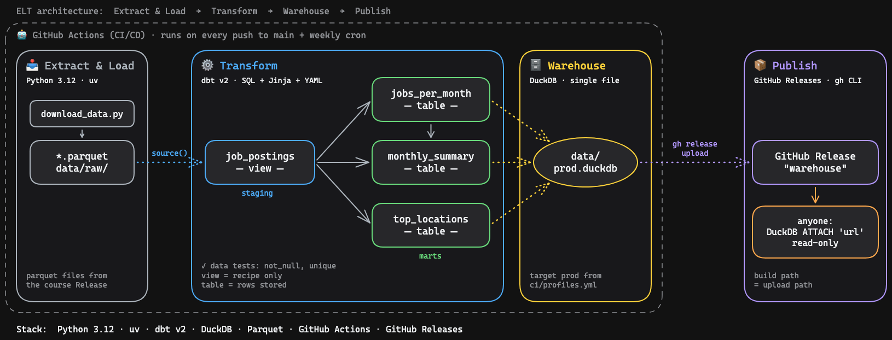
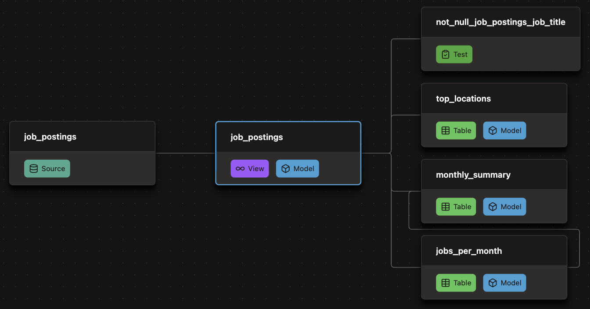

# dbt + DuckDB Job Postings Pipeline

[](https://github.com/Fede00729/dbt-duckdb-pipeline/actions/workflows/dbt_build.yml)
[](https://www.getdbt.com/)
[](https://duckdb.org/)
[](https://www.python.org/)
[](https://docs.astral.sh/uv/)



I've been working with dbt for almost 3 years. I'm following the course
**dbt for Data Analytics & Engineering** by Luke Barousse ([YouTube](https://youtu.be/1Bf049kXV2g))
to set up dbt from scratch on a different stack: first DuckDB (this repo), later Databricks.
This is my own version of the first project.

🚧 Work in progress (see [Progress](#progress)).

## What it does

It takes a year of raw job postings (parquet files) and turns them into a small warehouse
in a single DuckDB file. Every time I push, GitHub Actions rebuilds it, runs the tests and
uploads the result, so anyone can open it.

| Model | Layer | Type | What it is |
|---|---|---|---|
| `job_postings` | staging | view | Cleaned postings, scraper error rows removed |
| `jobs_per_month` | marts | table | Postings per month and role |
| `top_locations` | marts | table | Top 10 locations by postings |
| `monthly_summary` | marts | table | Monthly totals and % of remote postings |

All models have descriptions, and the key columns have `not_null` / `unique` tests.

Built with **dbt v2**, **DuckDB**, **uv**, **GitHub Actions** and **GitHub Releases**.

The lineage from dbt docs, colored by materialization:



## Try it

You only need [DuckDB](https://duckdb.org/). Open it and run:

```sql
INSTALL httpfs; LOAD httpfs;
ATTACH 'https://github.com/Fede00729/dbt-duckdb-pipeline/releases/download/warehouse/prod.duckdb' AS jobs;
SELECT month, pct_remote FROM jobs.monthly_summary ORDER BY month;
```

It's read-only. Heads up: `job_postings` won't work from your computer, because it's a view
that points to parquet files that only existed on the machine that built it. The three marts
are real tables, so those work.

## Run it on your machine

```bash
uv sync                            # install dbt
uv run scripts/download_data.py    # download the raw parquet files (from the repo root)
cd analytics
uv run dbt build                   # build the models and run the tests
```

dbt looks for a profile called `analytics` in `~/.dbt/profiles.yml`. Mine looks like this:

```yaml
analytics:
  target: dev
  outputs:
    dev:
      type: duckdb
      path: ../data/dev.duckdb
      threads: 1
```

The raw data and the `.duckdb` files are not in the repo (they're in `.gitignore`).

## How the automation works

The workflow is in [`.github/workflows/dbt_build.yml`](.github/workflows/dbt_build.yml).
It runs on every push to `main`, every Monday, or when I click **Run workflow** on GitHub.

GitHub gives it a brand-new machine each time, so my `~/.dbt/profiles.yml` isn't there.
That's why the repo has its own profile in [`ci/profiles.yml`](ci/profiles.yml). It's safe
to commit because DuckDB needs no passwords, only a file path.

The run installs everything, downloads the data, runs `dbt build` and uploads
`prod.duckdb` to the `warehouse` release. If a test fails, it stops there and the
published file stays as it was.

## Notes on DuckDB and dbt v2

Things that were new to me coming from dbt v1 on a cloud warehouse:

- **Sources can be plain files.** The source points straight to the parquet files with
  `external_location`, no loading step. In dbt v2 it goes under `config:` (dbt v1 used `meta:`).
- **Test parameters go under `arguments:`** in dbt v2. The old syntax still runs, with a
  deprecation warning.
- **`dbt show` adds its own `LIMIT`**, which clashes with a model that already ends with one.
  `--limit -1` turns it off.
- **`persist_docs` works on DuckDB**: the descriptions show up as column comments, readable from
  any SQL client.
- **The warehouse is just a file**, so publishing it is a file upload. The catch: a view
  travels without its data, which is why `job_postings` doesn't work from the published file.
- **CI with no secrets.** DuckDB needs only a path, so the CI profile can live in the repo. On a
  cloud warehouse the credentials would go in GitHub Secrets with `env_var()`.

## Progress

- [x] dbt v2 + DuckDB project from scratch, environment managed with uv
- [x] Raw parquet files read directly as a dbt source
- [x] Staging view + marts tables, documented and tested
- [x] Descriptions persisted into DuckDB (`persist_docs`)
- [x] CI with GitHub Actions, publishing the warehouse to a GitHub Release
- [ ] Docs site on GitHub Pages
- [ ] Project 2: the same pipeline on Databricks

---

The diagram is in [`assets/pipeline.excalidraw`](assets/pipeline.excalidraw) if you want to
open it in excalidraw.com. The data comes from the course's public dataset.
